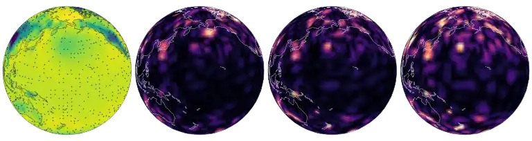
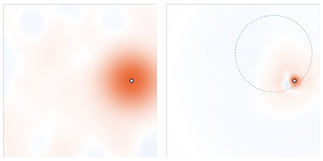
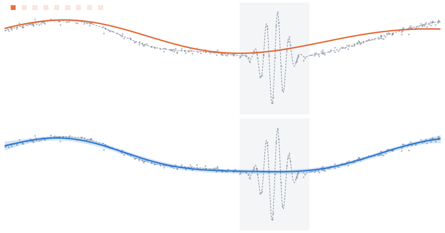

<div align="center">

# Scalable Random Wavelet Features

**Efficient non-stationary kernel approximation with convergence guarantees**

Sawan Kumar · Souvik Chakraborty  
Indian Institute of Technology Delhi · ICLR 2026

[](https://proceedings.iclr.cc/paper_files/paper/2026/file/ae292fe7ac000cb8e9e08ddc10d969a4-Paper-Conference.pdf)
[](https://arxiv.org/abs/2602.00987)
[](https://csccm-iitd.github.io/SRWF/)
[](LICENSE)



<sub>Reconstructing global surface pressure from 25% of the grid. Left to right: the field and its stations, then the errors of <b>RWF</b>, an exact GP and RFF.</sub>

</div>

Random Fourier features made Gaussian processes scale, but only for stationary kernels, which assume the same smoothness everywhere. **Random wavelet features** draw wavelet atoms at random locations and scales. They approximate non-stationary kernels without bias, converge uniformly, and keep exact GP inference at the cost of random Fourier features.

<p align="center">
  
  
</p>

## Highlights

- **Climate reconstruction on the sphere.** Six ERA5 fields reconstructed from sparse stations: best or tied-best error on five of six against SVGP, random Fourier features and an exact GP, with up to 17% lower error than the exact GP, in about 30 s per feature draw on one GPU.
- **Irregular functions on the sphere.** A single shallow RWF GP gives better test log-likelihood than residual deep GPs on manifolds (Wyrwal et al., 2025) at every training size, from 100 to 1,600 points.
- **Satellite temperature benchmark** (Heaton et al., 2019). Second on RMSE and first on interval score against the twelve published methods, with 105k observations on one GPU.
- **Large-scale regression.** Up to 1.8 million training points conditioned exactly in one pass; competitive with state-of-the-art GP solvers and up to 45× faster on the largest datasets.
- **Regression.** Strong accuracy and calibration on the standard UCI benchmarks, from under a thousand to forty-five thousand points.
- **Non-stationary signals.** Sharp where the signal is sharp and smooth where it is smooth; up to 2.8 times more accurate than an exact Matérn GP on localised bursts.

Full tables are on the [project page](https://csccm-iitd.github.io/SRWF/).

## Install

```bash
git clone https://github.com/csccm-iitd/SRWF.git && cd SRWF
pip install -e ".[all]"
```

## Quickstart

```python
from srwf import RWFGP

model = RWFGP(num_features=2048, levels=6).fit(x_train, y_train)
pred = model.predict(x_test)  # pred.mean, pred.std
paths = model.sample_posterior(x_test, n_samples=16)
```

Hyperparameters are learnt by the exact marginal likelihood, and the posterior conditions on all `N` points in one pass. `anchors=` enables location-dependent octave weights, and `fourier=` adds a random Fourier block. `restarts=` keeps the feature draw with the best marginal likelihood, `solver="dual"` conditions through the `N x N` kernel matrix when `N < D`, and `MixtureGP` averages independent feature draws. `RFFGP` exposes the same interface.

## Reproducing the results

Each table and figure has one script under `experiments/`, for example:

```bash
python experiments/benchmarks/uci.py
python experiments/climate/reconstruct.py --split test
python experiments/figures/synthetic_fits.py
```

Benchmark data downloads on first use. The climate experiments use ERA5 on the T30 Gaussian grid, as released with LUCIE (Guan et al., 2024); set `SRWF_ERA5` to its location. Run `pytest` to check the installation.

## Citation

```bibtex
@inproceedings{kumar2026scalable,
  title     = {Scalable Random Wavelet Features: Efficient Non-Stationary Kernel Approximation with Convergence Guarantees},
  author    = {Kumar, Sawan and Chakraborty, Souvik},
  booktitle = {International Conference on Learning Representations},
  year      = {2026},
  url       = {https://arxiv.org/abs/2602.00987}
}
```
